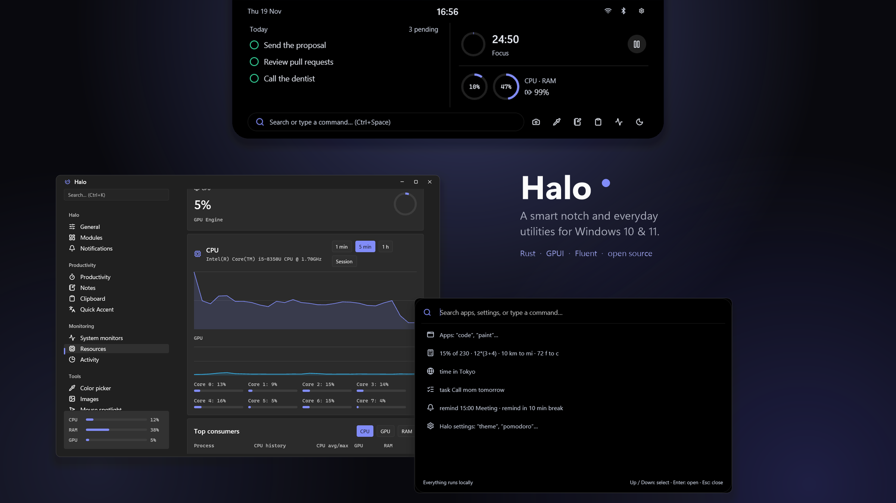
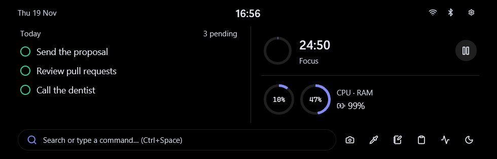
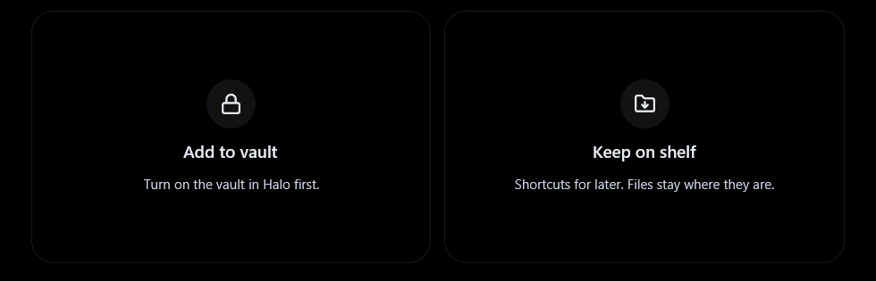
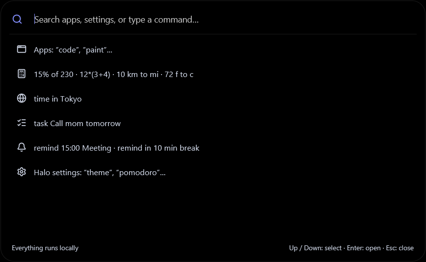
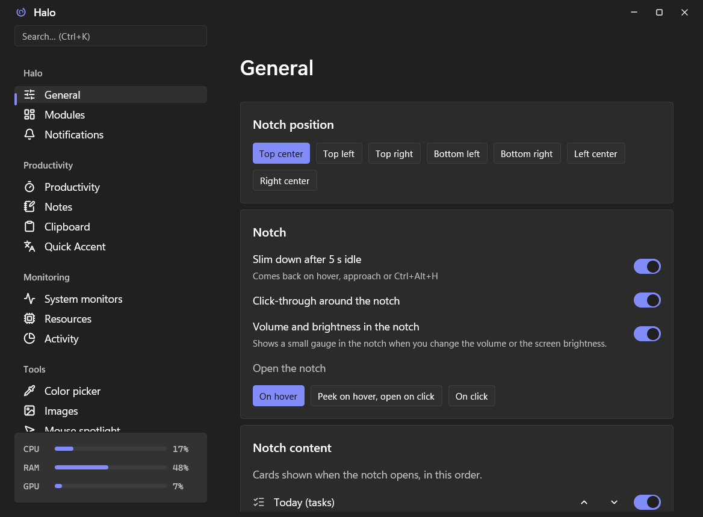
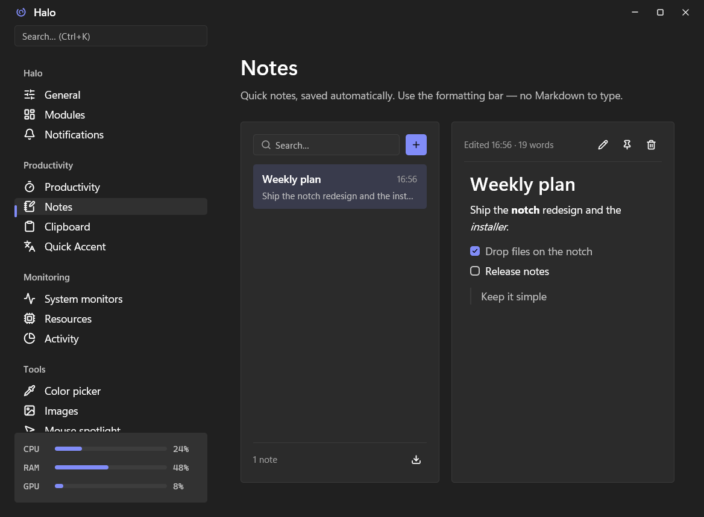
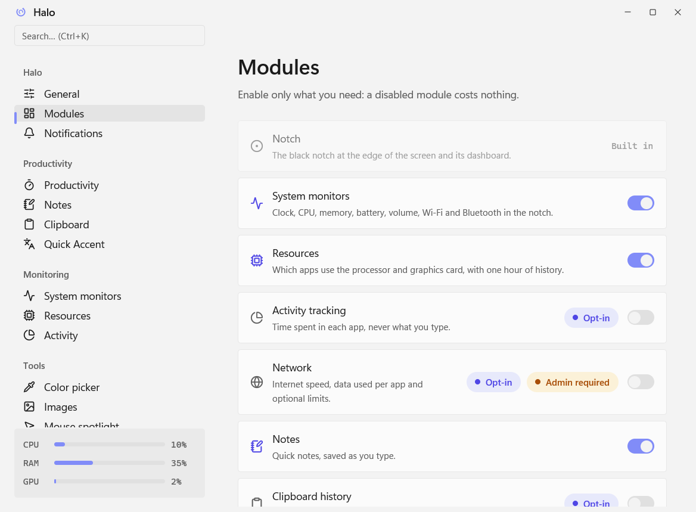
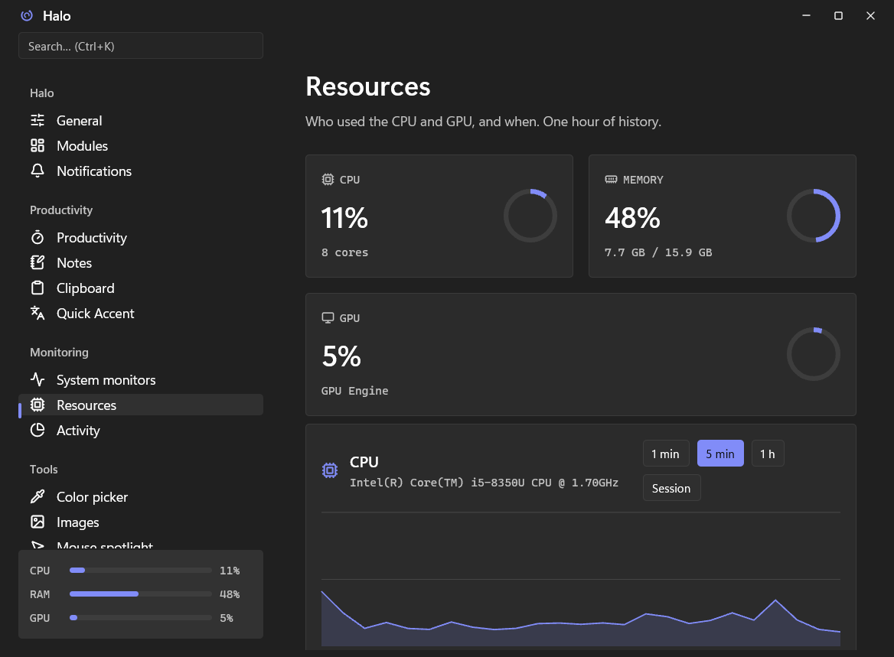
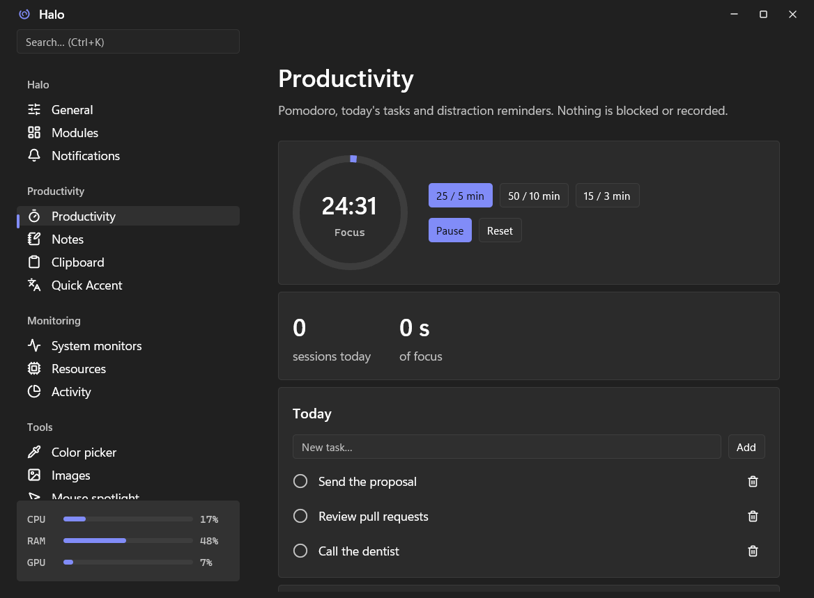
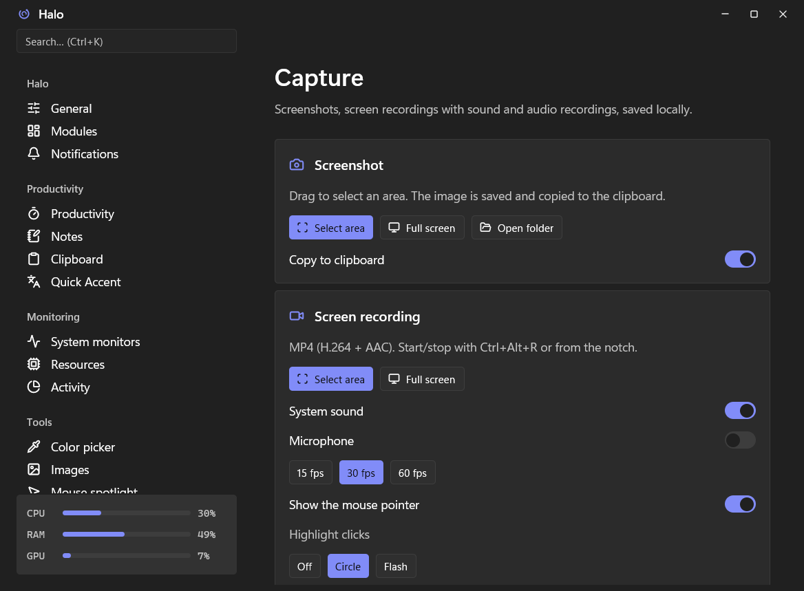

<p align="center">
  
</p>

<p align="center">
  
</p>

<h1 align="center">Halo</h1>

<p align="center">
  <b>A smart notch and a suite of everyday utilities for Windows 10 &amp; 11.</b><br>
  Written in Rust with GPUI · 100% local · no telemetry · open source
</p>

<p align="center">
  <a href="#features">Features</a> ·
  <a href="#install">Install</a> ·
  <a href="#keyboard-shortcuts">Shortcuts</a> ·
  <a href="#privacy">Privacy</a> ·
  <a href="#build-from-source">Build</a> ·
  <a href="#contributing">Contributing</a> ·
  <a href="#license">License</a>
</p>

<p align="center">
  
</p>

Halo puts a black, edge-attached **notch** on your screen — in the spirit of the Dynamic
Island — and turns it into the entry point for a set of small, polished tools: system
monitors, now playing, tasks and a focus timer, a launcher, clipboard history, notes,
a colour picker, screen and audio capture, an encrypted vault and more.

Every feature is an independent **module** you can switch off. A disabled module costs
nothing. Sensitive modules are **off until you opt in**, and everything stays on your PC.

## Screenshots

| Drop files on the notch | Launcher (`Ctrl+Space`) |
|---|---|
|  |  |

| Settings (Fluent, Mica) | Notes |
|---|---|
|  |  |

| Modules (light theme) | Per-process resources |
|---|---|
|  |  |

| Productivity | Capture |
|---|---|
|  |  |

## Features

### The notch
- A solid black shape attached to a screen edge with smooth inner corners. Seven
  positions (top, corners, sides), multi-monitor and per-monitor DPI aware.
- **Compact**: clock, CPU, battery, Wi-Fi… (you choose), plus *live activities* — focus
  timer, current track, recording timer, reminders and Windows notifications.
- **Open** (hover or click): a **customisable dashboard** — now playing for any app
  (Spotify, browsers…), today's tasks, a Pomodoro ring, CPU/RAM rings, clock and time
  zones, a command bar and your shortcuts. Empty cards hide themselves.
- **Quick controls**: volume and brightness sliders, Wi-Fi and Bluetooth toggles, and a
  small HUD in the notch when the volume or brightness changes.
- **Peek mode** (optional): hovering shows a one-line preview (track or next task);
  a click opens the full dashboard.
- **Drop files on it**: the notch opens into two zones — *Add to vault* (encrypted into
  your unlocked vault) and *Keep on shelf* (shortcuts you can open later from the
  notch). Your original files are never moved.
- Slims down when idle, hides while an app is fullscreen, can be dragged to another edge.
- Six flat themes: Midnight, Graphite, Ocean, Forest, Sunset, Violet.

### Launcher — `Ctrl+Space`
Installed apps, Halo features and settings, maths (`15% of 230`, `12*(3+4)`),
conversions (`10 km to mi`, `72 f to c`), time zones (`time in Tokyo`),
`task …`, `remind 15:00 …`, `note …`. Everything is evaluated locally; web search only
runs if you pick it.

### Modules

| Module | What it does |
|---|---|
| System monitors | CPU, RAM, battery, volume, brightness, Wi-Fi, Bluetooth — with controls in the notch |
| Resources | One hour of per-process CPU/GPU history, per-core usage, top consumers, peaks |
| Activity *(opt-in)* | Time per app and category — **never keystrokes** |
| Network *(opt-in)* | Live download/upload speed, usage history (today, 7 and 30 days), traffic per app; optional per-app limits (WinDivert, bundled) |
| Wi-Fi passwords *(opt-in)* | The networks this PC remembers and their passwords, revealed on demand |
| Notes | Formatted notes with a toolbar (no Markdown to type), folders, pins, search, auto-save, export |
| Clipboard history *(opt-in)* | Text, links, images with thumbnails; filters, search, pins, DPAPI encryption |
| Quick Accent | Hold a letter + `Space` or `←`/`→` to type é, è, ç, ñ, ß… (adjustable hold delay) |
| Images | Batch resize, compress, convert (WebP, JPEG, PNG, AVIF) |
| Vault *(opt-in)* | Encrypted folders (Argon2id + XChaCha20-Poly1305), recovery key |
| Colour picker | Magnifier, HEX/RGB/HSL/HSV/CMYK, history |
| Screenshot | Region, window or screen; clipboard; annotations |
| Screen recording | Region or screen to MP4 (H.264 + AAC), system sound and/or mic, mouse pointer and click highlights; pause/stop from the notch |
| Audio recorder | Microphone (your choice, with a level test) and/or system sound to WAV or FLAC |
| Music | MP3/FLAC/WAV/OGG/M4A, library, playlists, "Play with Halo" in Explorer |
| Mouse spotlight | Shake the mouse to find the cursor; a click dismisses it |
| Windows theme | Light/dark in one click, wallpaper and accent per mode, schedule |
| Launch at startup | Start with Windows (with administrator rights, no prompt) |
| Themes | Light / dark / follow Windows |
| Productivity | Pomodoro, tasks, reminders, gentle distraction reminders |
| Notifications *(opt-in)* | Windows notifications in the notch, Do Not Disturb |

**Languages:** English, Français, Español, Deutsch, Italiano, Русский, 简体中文, 日本語, Português.

## Install

Download the latest **`halo-x.y.z-x64.msi`** from [Releases](../../releases) and run it.
Requires Windows 10 21H2+ or Windows 11 (x64).

The installer is not code-signed yet, so Windows SmartScreen may warn on first launch
(*More info → Run anyway*). Each release ships a `.sha256` checksum.

Halo runs **as administrator** (the network limiter, per-app live speeds and the
startup task need it): Windows asks once when you start it by hand; at sign-in it
starts elevated without a prompt. A small non-elevated helper keeps drag-and-drop from
Explorer onto the notch working.

**Updates:** Halo checks this repository's latest release at startup and once a day
(Settings › General › Updates, can be turned off) and offers to download and install it.

## Keyboard shortcuts

| Shortcut | Action |
|---|---|
| `Ctrl+Space` | Launcher (also `Ctrl+Alt+Space`) |
| `Ctrl+Alt+H` | Show / open / close the notch |
| `Ctrl+Alt+C` | Colour picker |
| `Ctrl+Alt+S` | Screenshot of a region |
| `Ctrl+Alt+R` | Start / stop screen recording |
| `Ctrl+K` | Search the settings hub |
| Hold a letter + `Space` (or `←`/`→`) | Quick Accent |

## Privacy

- **100% local.** No telemetry, no account, no server. Data lives in `%APPDATA%\Halo`
  (a TOML config and a SQLite database).
- **Sensitive modules are opt-in** — activity, clipboard history, vault, network and
  notifications explain what they do before you enable them.
- **No keylogging, by design.** The only keyboard hook powers Quick Accent and records
  nothing.
- The clipboard history skips content marked sensitive (password managers) and can be
  encrypted with Windows DPAPI. Activity tracking ignores window titles unless you turn
  them on, and idle time is not counted.
- The launcher's web search only runs when you explicitly choose it.
- The only automatic network request is the update check (GitHub's public release list);
  it can be turned off.
- Wi-Fi passwords are read from Windows only when you open that page, never stored, and
  copied without entering clipboard history.

## Build from source

### Requirements

- Windows 10/11 x64
- [Rust](https://rustup.rs) — the toolchain is pinned in `rust-toolchain.toml` (MSVC target)
- MSVC C/C++ build tools: [Visual Studio Build Tools](https://visualstudio.microsoft.com/visual-cpp-build-tools/)
  with the *Desktop development with C++* workload (or LLVM + [xwin](https://github.com/Jake-Shadle/xwin))
- [CMake](https://cmake.org) (image codecs)
- [WiX Toolset 3.14](https://github.com/wixtoolset/wix3/releases) — only to build the installer

### Develop

```powershell
cargo run -p halo-app                      # debug build: runs without administrator rights
$env:RUST_LOG = "debug"; cargo run -p halo-app   # verbose logs
cargo check --workspace                    # fast type-check of every crate
cargo clippy --workspace                   # lints
cargo fmt --all                            # format
```

Debug builds never ask for elevation, so they are convenient to iterate on; features
that need administrator rights (network limiter, live per-app speeds) say so in the UI.

### Test

```powershell
cargo test -p halo-ui --no-default-features   # design tokens: contrast, theme sync (fast)
cargo test -p halo-core -p halo-modules -p halo-platform -p halo-capture -p halo-secure
cargo test --workspace                        # everything
```

### Build a release and the installer

```powershell
cargo build --release -p halo-app             # target\release\halo.exe
.\scripts\build-msi.ps1 -SkipBuild            # dist\halo-<version>-x64.msi + .sha256
.\scripts\build-msi.ps1                       # both steps in one go
```

The MSI script downloads WinDivert (pinned by SHA-256) into `target\windivert` the
first time. The version comes from `version` in the root `Cargo.toml`: bump it, build
the MSI, then publish a GitHub release tagged `vX.Y.Z` with the `.msi` and `.sha256`
attached — installed copies of Halo pick it up through the update check.

### Workspace

| Crate | Purpose |
|---|---|
| `halo-ui` | Design tokens, spring animation, GPUI / gpui-kit glue |
| `halo-core` | Config, `Module` trait and supervised registry, event bus, notch geometry, i18n |
| `halo-platform` | Win32 / WinRT layer (windows, monitors, hooks, audio, media, notifications…) |
| `halo-modules` | Monitors, notes, clipboard, images, activity, music, tasks, focus, launcher… |
| `halo-capture` | Screenshot, screen recording, audio recorder |
| `halo-secure` | Encrypted vault, network monitor / limiter |
| `halo-app` | The application: notch, hub, launcher, tray |

Translations live in [`crates/halo-core/locales/`](crates/halo-core/locales) (one TOML
file per language; a test checks every key exists everywhere). The design tokens
(colours, spacing, radii, type) live in [`crates/halo-ui/src/tokens.rs`](crates/halo-ui/src/tokens.rs).

## Contributing

Issues and pull requests are welcome. Please keep to the project's principles:

- one flat accent colour (`#818CF8`), no gradients, neutral greys;
- [Lucide](https://lucide.dev) icons — never emoji;
- everything local, sensitive features opt-in;
- tests for any pure logic (`cargo test --workspace`);
- new UI strings go into every locale file.

## License

Dual-licensed under either of [MIT](LICENSE-MIT) or [Apache 2.0](LICENSE-APACHE), at
your option.

Built with [GPUI](https://github.com/zed-industries/zed) and
[gpui-kit](https://github.com/longbridge/gpui-kit) (Apache 2.0). Icons by
[Lucide](https://lucide.dev) (ISC).
